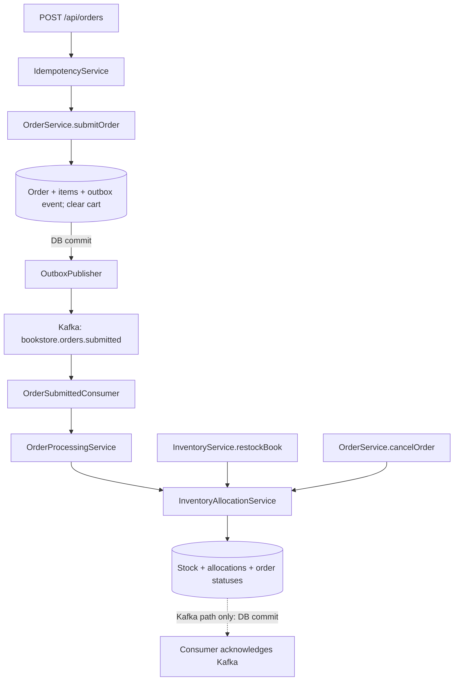

# Bookstore Backend API

A Java/Spring Boot backend for an online bookstore, built as a technical assignment. The focus is on clear business rules, transactional consistency, concurrency, and asynchronous order processing.

## Tech stack and architecture

- **Java 21**, **Spring Boot 4.1.2**, Spring Security (JWT), Maven
- **PostgreSQL 17**, **Flyway**, Spring JDBC (`NamedParameterJdbcTemplate`)
- **Apache Kafka**, Docker Compose, JUnit, Mockito, Testcontainers
- **Lightweight hexagonal architecture**, organized by feature (`auth`, `user`, `category`, `book`, `cart`, `order`, `inventory`, `idempotency`, `outbox`, `messaging`):
  - `api`  -  REST controllers and request/response DTOs
  - `application`  -  business logic; `application.port`  -  repository interfaces
  - `domain`  -  business models and enums
  - `infrastructure`  -  JDBC implementations, Kafka publisher/consumer

Persistence uses explicit SQL rather than JPA entities. Flyway migrations (`V1`–`V6`) define the database schema.

## Business logic

- **Authentication and users:** Customers register/login with a short-lived JWT. Passwords are hashed with BCrypt. Authenticated users can retrieve/update their profile and change their password. Public users can browse books/categories; administrative writes require the `ADMIN` role.
- **Books and categories:** Books have unique ISBNs, prices, stock, and multiple categories. Books can be archived/restored to preserve order history. Listing supports combinable `title`, `author`, `categoryId`, `page`, and `size` parameters. Metadata updates do not change stock; restocking has a dedicated endpoint.
- **Cart:** One cart per user, created on first add. Adding/removing a book changes its quantity by **one**; it does not reserve stock. Archived books already in a cart are removed lazily when the cart is read. Checkout clears cart items but keeps the cart.
- **Checkout:** An authenticated customer can submit a non-empty cart even when stock is insufficient. The API synchronously creates a `PENDING` order; each `order_item` stores the quantity and the **price at purchase** (`unit_price`). Inventory is allocated separately, normally through Kafka.
- **Orders:** Customers see their own orders. Administrators can list all orders with pagination, inspect individual orders, cancel unshipped orders, ship confirmed orders, and mark shipped orders as delivered. Order items track `allocated_quantity` and `backordered_quantity`.

## Order submission and lifecycle

Order submission is synchronous, while the initial inventory allocation is driven asynchronously by Kafka. The submission response means that the order has been accepted and persisted, not that stock has been reserved or the order is ready to ship.



The acknowledgment step applies only to the Kafka consumer path. Restocking and cancellation invoke the same allocation service synchronously in their own transactions.

### Submission transaction

1. `OrderController.submitOrder()` requires an `Idempotency-Key` and calls `IdempotencyService.execute()`.
2. `OrderService.submitOrder()` locks the customer's cart, retrieves its items, and rejects an empty cart.
3. It locks active books with `SELECT ... FOR SHARE` in ascending book-ID order, validates their availability in the catalog, and captures their current prices. Multiple transactions can hold compatible shared locks; conflicting book updates must wait. Stock sufficiency is not a checkout requirement.
4. It saves a `PENDING` order and its items, initially with both allocated and backordered quantities equal to zero.
5. It inserts an `ORDER_SUBMITTED` event into `outbox_events` and clears the cart items.
6. The idempotency record, business changes, outbox event and original HTTP `201 Created` response commit in one PostgreSQL transaction. The API does not wait for Kafka publishing or inventory allocation.

### Order statuses

| Status | Meaning |
| --- | --- |
| `PENDING` | Order persisted; not all order items have been classified as allocated or backordered. |
| `PROCESSING` | The outbox publisher has claimed the submission event while the order was `PENDING`; publishing or allocation may still be pending or retrying. |
| `BACKORDERED` | All items have been classified, but at least one has an outstanding backordered quantity. Some or none of the requested inventory may have been allocated. |
| `CONFIRMED` | All requested quantities have been allocated. |
| `SHIPPED` | An administrator has marked a fully allocated, confirmed order as dispatched. |
| `DELIVERED` | An administrator has marked a shipped order as delivered. |
| `CANCELLED` | An unshipped order has been cancelled and its allocations released. |

Typical transitions:

```text
PENDING -> PROCESSING -> CONFIRMED -> SHIPPED -> DELIVERED
                     \-> BACKORDERED -> CONFIRMED
PENDING -> CONFIRMED / BACKORDERED (allocation by another event or restock)
PENDING / PROCESSING / BACKORDERED / CONFIRMED -> CANCELLED
```

`PROCESSING` is not mandatory: another order's event, restocking, or cancellation can trigger allocation before an order's own event is claimed or consumed. The publisher updates only `PENDING` orders to `PROCESSING`, so it cannot reopen an already classified or cancelled order. `PENDING` or `PROCESSING` can also persist while some items remain unclassified. `BACKORDERED` is a valid accepted order state, not a rejection.

## Transactional outbox

Saving an order and directly publishing to Kafka would create a dual-write problem: the database transaction could commit while publishing fails, or Kafka could receive an event for a transaction that rolls back. The transactional outbox records the event in the same database transaction as the order; a separate publisher delivers it to Kafka later.

### Outbox data model

The `outbox_events` table stores:

| Column(s) | Purpose |
| --- | --- |
| `id` | UUID identifying the event; also used as Kafka `eventId`. |
| `aggregate_type`, `aggregate_id` | Entity type and ID associated with the event (e.g. `ORDER`, `123`). |
| `event_type`, `payload` | Event type (`ORDER_SUBMITTED`) and JSONB event data. |
| `status` | `PENDING` (default), `IN_PROGRESS`, or `PUBLISHED`; independent of order status. |
| `attempts`, `next_attempt_at` | Claim count and earliest eligible time for another attempt. |
| `claim_token`, `locked_until` | UUID identifying a claim batch and its expiry time; protects against stale publishers and enables crash recovery. |
| `created_at`, `published_at`, `last_error` | Timestamps and diagnostics. |

Currently only order submission writes an outbox event. `BOOK_RESTOCKED` and its Kafka topic are defined, but no restock event is created or consumed by the current restocking flow.

### Publishing and retries

`OutboxPublisher` calls `OutboxClaimService` and `KafkaOutboxProducer`:

1. The scheduler first runs after **10 seconds**, then by default **5 seconds after the preceding execution finishes** (`bookstore.outbox.poll-delay-ms`).
2. Each cycle requeues up to **100** expired `IN_PROGRESS` rows as `PENDING`.
3. `OutboxClaimService.claimAndMark()` atomically claims up to **5** eligible `PENDING` rows, ordered by `next_attempt_at`, `created_at`, and `id`. It assigns a new claim token, a **2-minute** lease, increments `attempts`, and marks associated `PENDING` orders as `PROCESSING`. These changes commit together before network publishing.
4. The SQL uses `FOR UPDATE SKIP LOCKED`, allowing multiple application instances to claim different rows without waiting for one another's outbox row locks. The lease is persisted metadata, not a database row lock held during Kafka I/O.
5. For each claimed event, `KafkaOutboxProducer.publish()` sends a Kafka record. The publisher waits up to **10 seconds** on the returned future. After Kafka acknowledges, it attempts to mark the row `PUBLISHED` and clears its claim.
6. On failure or timeout, it attempts to release the event as `PENDING` with exponential backoff: `2^min(attempts, 8)` seconds (2, 4, 8, …, 256 seconds). The delay is the earliest eligibility time, not an exact retry schedule; the scheduler polls later. Completion and retry updates require the matching `claim_token` and `IN_PROGRESS` status.
7. On thread interruption, the publisher restores the interrupt flag, attempts to schedule a retry for the current event, and stops the loop. Unprocessed claims can be recovered when their leases expire.

A crash after Kafka accepts an event but before PostgreSQL records `PUBLISHED`, or a send timeout with an uncertain outcome, can cause the event to be sent again. Producer idempotence and `acks=all` are configured, but they do not eliminate duplicate application-level republishes. This is an **at-least-once publishing design**, not an end-to-end exactly-once guarantee; consumer deduplication is required. The current code does not cap retry attempts or delete published outbox rows.

### Kafka message format

Example for order `123`:

| Component | Value |
| --- | --- |
| Config property | `bookstore.kafka.topics.order-submitted` |
| Topic (default) | `bookstore.orders.submitted` |
| Key | `ORDER:123` (`<aggregate_type>:<aggregate_id>`) |
| Payload | `{"orderId":123}` |
| Header `eventId` | UUID from `outbox_events.id` |
| Header `eventType` | `ORDER_SUBMITTED` |

The key groups messages for the same aggregate into a Kafka partition; it does not establish chronological allocation priority across different orders. That priority is implemented in PostgreSQL.

### Why Kafka for Order Processing?

Order submission and inventory allocation are separated into synchronous
and asynchronous operations. The API accepts and persists the order,
while Kafka enables inventory allocation to be performed independently
of the HTTP request lifecycle.

This approach reduces API response times, accommodates traffic spikes
and prevents customers from waiting for inventory allocation and
database lock acquisition.

Although asynchronous processing could also be achieved using a
scheduled worker that processes events directly from the `outbox_events`
table, Kafka provides additional architectural benefits:

- **Independent consumers:** Multiple consumer groups can process the
  same event independently, enabling future integrations such as
  notifications, analytics and fulfillment.
- **Horizontal scalability:** Partition-based workload distribution
  and automatic consumer rebalancing reduce the need for custom
  coordination between processing instances.
- **Reduced database dependency:** Downstream consumers retrieve events
  from Kafka instead of continuously polling the outbox table.
- **Event retention and replay:** Historical events can be reprocessed
  for recovery, analytics or newly introduced consumers within the
  configured retention period.
- **Ordering guarantees:** Aggregate-based message keys enable
  partition-level ordering of related events.
- **Service decoupling:** Business components can evolve into
  independently deployed and scaled services without requiring direct
  access to the producer's database.

The **Transactional Outbox** pattern addresses the dual-write problem
between PostgreSQL and Kafka, while **consumer-side idempotency**
protects against duplicate event deliveries.

Kafka does not replace database concurrency control. Inventory
consistency is still maintained through pessimistic locking,
deterministic lock ordering and atomic database transactions.

#### Architectural Trade-offs

Kafka introduces additional infrastructure, operational complexity,
eventual consistency and failure scenarios.

For the current application size, a database-backed scheduled worker
would be a simpler and perfectly viable alternative. Kafka was
deliberately chosen to support future extensibility, distributed
processing and the evolution towards an event-driven architecture,
rather than being a strict functional requirement.

## Order consumer and inventory allocation

```text
OrderSubmittedConsumer -> OrderProcessingService -> InventoryAllocationService
InventoryController -> IdempotencyService -> InventoryService -> InventoryAllocationService
OrderController / AdminOrderController -> IdempotencyService -> OrderService
                                                            -> InventoryAllocationService (cancellation)
```

### Consumer processing

`OrderSubmittedConsumer` listens in group `bookstore-order-processor` using `MANUAL_IMMEDIATE` acknowledgment. It validates the event type, parses `eventId` and `orderId`, and delegates business logic to `OrderProcessingService.processOrder()`.

Within the processing transaction:

1. Insert a marker into `processed_kafka_events` using `(event_id, consumer_name)` with `consumer_name = ORDER_PROCESSOR`. `INSERT ... ON CONFLICT DO NOTHING` makes a duplicate delivery a no-op.
2. Retrieve the order without taking an order row lock at this point. Continue only for `PENDING` or `PROCESSING`; other statuses have already been classified or are no longer eligible for initial processing. A missing order or empty order item list is an error.
3. Retrieve the order items and collect distinct book IDs, sorted in ascending order.
4. **Lock all affected books first** with `SELECT ... FOR UPDATE` (without `NOWAIT`). This is important: the current implementation pre-locks all books before it starts allocating any of them.
5. For each book, call `InventoryAllocationService.allocateOutstandingForBook()`, which reuses the existing book lock and updates outstanding demand.
6. Commit the processed-event marker, allocations, stock changes and status changes together. Only after the service returns successfully does the consumer acknowledge the Kafka message. If processing rolls back, the marker rolls back too, allowing a later delivery to retry. If commit succeeds but acknowledgment fails, the marker protects against repeating database effects.

### Allocation algorithm and backorder priority

`InventoryAllocationService.allocateOutstandingForBook()` is annotated with `@Transactional(propagation = Propagation.MANDATORY)`: it requires an existing transaction and cannot commit its changes independently.

For each book:

1. Acquire its exclusive row lock using `SELECT ... FOR UPDATE`. Concurrent inventory operations on the same book wait rather than skip the book or immediately fail. Ordinary non-locking reads are not blocked by this lock.
2. Query order items for that book where `allocated_quantity < quantity` and the order is `PENDING`, `PROCESSING`, or `BACKORDERED`. Sort by order creation time, order ID, and item ID (ascending).
3. For each outstanding item, compute the remaining demand and allocate as much as current stock permits:

   ```text
   remaining      = quantity - allocated_quantity
   allocatedNow   = min(availableStock, remaining)
   newAllocated   = allocated_quantity + allocatedNow
   newBackordered = quantity - newAllocated
   availableStock = availableStock - allocatedNow
   ```

   Remaining demand is not simply `backordered_quantity`: newly submitted items initially have zero allocated and zero backordered quantities, despite having outstanding demand.
4. Update changed order items and decrease the book's stock by the total newly allocated quantity. Allocations cannot intentionally exceed the available stock.
5. Refresh statuses of affected orders in ascending order-ID order. If any item is still unclassified, keep `PROCESSING` or set `PENDING`; otherwise, any backordered quantity implies `BACKORDERED`, and a fully allocated order becomes `CONFIRMED`. The SQL excludes cancelled and fulfilled orders from these updates.

Allocation is **book-centric**, not limited to the order that triggered the Kafka event. It processes eligible, visible outstanding items oldest first, including orders whose own submission events have not been consumed. This means Kafka delivery order does not determine who receives the last copy of a book. It does not guarantee a global FIFO order across uncommitted transactions or across all books.

For example, if 100 customers each submit a one-copy order for a book with one available copy and all orders are committed before allocation begins, one order receives the copy and the other 99 become backordered. All 100 can be accepted; only one copy can be allocated. A later restock serves the oldest eligible outstanding orders first.

### Restocking

`POST /api/books/{bookId}/restock` is an idempotent, synchronous admin operation. It returns `204 No Content` on success.

`InventoryService.restockBook()` locks the book row, rejects archived books, increases stock, and calls the same allocation service before committing. The new units are offered to outstanding orders first, and any remaining units stay available in `books.stock`. A concurrent allocator for the same book waits for the lock and then sees the committed inventory state.

Archived books cannot be newly ordered or restocked through this endpoint, but previously accepted orders can still participate in allocation and cancellation because inventory locks include archived books.

## Order fulfillment and cancellation

### Shipping and delivery

| Endpoint (admin only) | Allowed transition |
| --- | --- |
| `POST /api/admin/orders/{id}/ship` | `CONFIRMED` → `SHIPPED`; order must contain at least one item and every item must be fully allocated with zero backordered quantity. |
| `POST /api/admin/orders/{id}/deliver` | `SHIPPED` → `DELIVERED`. |

Both operations are synchronous, require an `Idempotency-Key`, and return the updated order (`200 OK`). Conditional SQL updates enforce valid transitions even when requests compete. Missing orders return `404`; invalid transitions return `409`. A retry with the original key replays the original result; a new key attempting the already-completed transition receives a conflict. Stock is not decremented again at shipping because it was already reserved during allocation. See `requests/order-fulfillment.http`.

### Cancellation

Customers can cancel their own unshipped orders via `POST /api/orders/{id}/cancel`; admins can cancel any unshipped order via `POST /api/admin/orders/{id}/cancel`. Both require `Idempotency-Key` and return the updated order (`200 OK`).

`PENDING`, `PROCESSING`, `BACKORDERED`, and `CONFIRMED` are cancellable. Repeating cancellation of a `CANCELLED` order returns that order without releasing inventory again. `SHIPPED` or `DELIVERED` orders return `409`; a missing order or another customer's order returns `404` on the customer endpoint.

The controller delegates through `IdempotencyService` to `OrderService.cancelMyOrder()` or `cancelOrderAsAdmin()`, which call the private `cancelOrder()` method:

1. Read the order items to identify distinct affected book IDs; the book IDs of submitted order items do not change.
2. Lock all affected books in ascending ID order, including archived books.
3. Lock the order with `SELECT ... FOR UPDATE` and validate its ownership and current status. Reread its items to obtain the latest allocation quantities.
4. Mark the order `CANCELLED` using a conditional SQL update before returning any inventory.
5. Restore **only allocated quantities** to stock; clear allocated and backordered quantities for cancelled items. Backordered units were never reserved and must not be refunded as stock.
6. Invoke `InventoryAllocationService.allocateOutstandingForBook()` for books whose inventory was restored, prioritizing outstanding orders.
7. Commit the cancellation, stock refund, reassignment and idempotency response atomically.

A delayed or replayed `ORDER_SUBMITTED` event cannot reallocate cancelled items: the consumer skips ineligible statuses and the allocation query excludes `CANCELLED` orders. See `requests/order-cancellation.http`.

### Lock ordering and concurrency

Inventory mutations coordinate through book row locks. Both multi-book order processing and cancellation acquire all relevant book locks in ascending order before updating order statuses. Restocking locks its single book first.

The consumer does not lock its triggering order before locking books: doing so would invert the book → order locking sequence used by allocation and could deadlock with restocking or cancellation. Individual order-item locks are not acquired explicitly before allocation because same-book mutations are serialized by the book lock; SQL `UPDATE` statements still acquire the necessary row locks. Shipping and delivery use order-only conditional updates without acquiring book locks.

Consistent lock ordering reduces deadlock risk, but does not prove that every multi-order/multi-book interaction is deadlock-free. Allocation across disjoint books can still involve overlapping order rows; status refresh visibility under concurrent transactions and retry/reconciliation behavior need further verification. Locks protect the inventory invariant, not strict global ordering or request deduplication.

## Idempotency

The project handles duplicate requests at two separate boundaries: HTTP request retries and Kafka event redelivery. They use different identifiers and tables because they solve different problems.

### HTTP requests

The following operations require an `Idempotency-Key` header: book creation, order submission, restocking, customer/admin order cancellation, shipping, and delivery. Other endpoints do not use this shared key mechanism; in particular, cart add/remove intentionally changes quantity by one on every successful call.

The `idempotency_requests` table has a unique constraint on `(user_id, operation, idempotency_key)`. It stores the request hash, response status, JSON response body, creation time and expiry time. User ID and operation isolate different callers and business actions.

`RequestHasher` computes a SHA-256 hash of a JSON representation of the request target and request body, with object properties and map entries sorted. Including the target distinguishes resource IDs. For example:

```java
requestHasher.hash("POST /api/books", request);
requestHasher.hash("POST /api/orders", Map.of());
```

`IdempotencyService.execute()` takes a `Supplier<ResponseEntity<?>>` so a common transaction wrapper can run different operations returning different response types, including empty responses. It uses `INSERT ... ON CONFLICT DO NOTHING RETURNING *` to claim the key atomically, executes the action only if the claim succeeds, and persists the result. Replays reconstruct the stored JSON as a Jackson tree rather than the original DTO; the service replays status/body, not arbitrary response headers.

| Situation | Result |
| --- | --- |
| New key | Execute the action and save its status/body. |
| Existing key, same hash, completed record | Replay the original HTTP status/body without executing the action again. |
| Existing key, different hash | `409 Conflict`. |
| Existing key, same hash, incomplete record | `409 Conflict` with `Retry-After: 1`. |
| Business action throws a rollback-triggering exception | Business changes and the newly claimed idempotency record roll back together; a retry can claim the key again. |

Under concurrent requests with the same key, PostgreSQL's unique constraint may make the second insert wait for the first transaction. If the first commits, the second can replay its completed record; if it rolls back, the second may acquire the claim instead. The incomplete-record branch is defensive, not the normal response to a simultaneous retry in this single-transaction design.

**Bodyless checkout:** `POST /api/orders` hashes an empty map and a fixed target. The hash does not include the cart contents. If the client changes the cart and submits a new order using the same key, the service replays the original order response while the record exists. Clients must generate a new key for each intended purchase and reuse that key only for retries of the same purchase. Replaying a checkout response returns the original snapshot (usually `PENDING`); use `GET /api/orders/{id}` to retrieve current status.

**Retention:** A new key is given a 24-hour expiry. `IdempotencyCleanupScheduler` starts approximately one minute after startup, then runs with a default fixed delay of 15 minutes (`bookstore.idempotency.cleanup-delay-ms`). It deletes expired records in batches of 500, up to 20 batches (10,000 rows) per run, using `FOR UPDATE SKIP LOCKED` and separate atomic SQL statements. Expiration does not immediately disable replay: an expired record can still be used until cleanup deletes it. After deletion, the same key can execute again. The mechanism is therefore not permanent deduplication.

Business-level uniqueness is separate from idempotency: two admins with different keys could submit the same ISBN. PostgreSQL's unique ISBN constraint handles that race even if both preliminary existence checks pass. Cart locking protects against lost quantity updates, but a retried add/remove request can still apply twice.

### Kafka event idempotency

The `processed_kafka_events` table has a composite primary key `(event_id, consumer_name)`. `OrderProcessingService` uses the event UUID from the Kafka header and `ORDER_PROCESSOR` as its logical consumer name. The marker is inserted in the same database transaction as the processing effects (see the consumer flow above). This gives effectively-once committed database effects for duplicate deliveries of the **same event**, not exactly-once Kafka transport or protection against different events with different IDs. There is currently no cleanup scheduler for this table.

## Run locally

**Requirements:** JDK 21, Docker Desktop / Docker Compose, and available ports **5432**, **9092**, and **8080**. Commands below use Windows PowerShell.

1. From the project root, set `DB_PASSWORD` to a local password and generate a Base64-encoded 32-byte `JWT_SECRET`. Run the remaining commands from the same PowerShell session so Docker Compose and Spring Boot receive the environment variables.

   ```powershell
   $env:DB_PASSWORD = Read-Host 'PostgreSQL password'
   $bytes = New-Object byte[] 32
   $rng = [System.Security.Cryptography.RandomNumberGenerator]::Create()
   $rng.GetBytes($bytes)
   $env:JWT_SECRET = [Convert]::ToBase64String($bytes)
   $rng.Dispose()
   ```

   Alternatively, use a local `.env` file (see `.env.example`); Compose reads it, and Spring imports it as a properties file. Do not commit real secrets.

   If PostgreSQL already has a data volume, enter the current password for the `bookstore` role. Changing `DB_PASSWORD` only sets the database password when PostgreSQL initializes a fresh volume.

2. Start PostgreSQL and Kafka:

   ```powershell
   docker compose up -d
   ```

3. Create the Kafka topic:

   ```powershell
   docker exec bookstore-kafka /opt/kafka/bin/kafka-topics.sh --bootstrap-server localhost:9092 --create --if-not-exists --topic bookstore.orders.submitted --partitions 3 --replication-factor 1
   ```

4. Start Spring Boot:

   ```powershell
   .\mvnw.cmd spring-boot:run
   ```

   The API runs at **http://localhost:8080**. Flyway applies database migrations at startup.

5. Register/login with `/api/auth/register` and `/api/auth/login`. Send the access token as `Authorization: Bearer <token>`. All newly registered users have the `USER` role. To try admin endpoints **locally only**, register an account, then promote it in the local database and log in again:

   ```powershell
   docker exec bookstore-postgres psql -U bookstore -d bookstore -c "UPDATE users SET role = 'ADMIN' WHERE email = 'admin@example.com';"
   ```

   Replace the email with the account you registered. Example requests are in `requests/*.http` (IntelliJ HTTP Client).

## Main API routes

All routes below use `/api` as their prefix. Authentication and admin permissions are enforced by Spring Security. The key column indicates endpoints that require `Idempotency-Key`.

| Method and route | Access / purpose | Key required |
| --- | --- | --- |
| `POST /api/auth/register`, `POST /api/auth/login` | Public; registration and JWT login | No |
| `GET /api/users/me`, `PUT /api/users/me` | Authenticated; view/update profile | No |
| `PUT /api/users/me/password` | Authenticated; change password | No |
| `GET /api/books`, `GET /api/books/{id}` | Public; catalog listing/detail | No |
| `GET /api/categories`, `GET /api/categories/{id}` | Public; category listing/detail | No |
| `POST /api/categories`, `PATCH/DELETE /api/categories/{id}` | Admin; category management | No |
| `POST /api/books` | Admin; create book | Yes |
| `PATCH/DELETE /api/books/{id}` | Admin; update metadata/archive | No |
| `PUT /api/books/{id}/restore` | Admin; restore archived book | No |
| `POST /api/books/{bookId}/restock` | Admin; restock and allocate | Yes |
| `GET /api/cart`, `POST/DELETE /api/cart/items/{bookId}` | Authenticated; cart and one-at-a-time quantity changes | No |
| `POST /api/orders` | Authenticated; submit cart | Yes |
| `GET /api/orders`, `GET /api/orders/{id}` | Authenticated; own order history/detail | No |
| `GET /api/admin/orders`, `GET /api/admin/orders/{id}` | Admin; paginated list/detail | No |
| `POST /api/orders/{id}/cancel` | Authenticated; cancel own unshipped order | Yes |
| `POST /api/admin/orders/{id}/cancel` | Admin; cancel unshipped order | Yes |
| `POST /api/admin/orders/{id}/ship` | Admin; ship confirmed, fully allocated order | Yes |
| `POST /api/admin/orders/{id}/deliver` | Admin; deliver shipped order | Yes |

## Testing

The source tree includes JUnit/Mockito service tests and PostgreSQL 17 integration tests using Testcontainers and Flyway. Existing scenarios include book/category service behavior, concurrent duplicate-ISBN creation, fulfillment transitions, cancellation and stock reassignment, cancellation rollback, and competing shipping/cancellation transitions. Docker-backed tests are disabled when Docker is unavailable.

Run the test suite from the project root (Windows PowerShell):

```powershell
.\mvnw.cmd test
```

The current test suite is an initial foundation, not exhaustive concurrency, HTTP, or end-to-end Kafka coverage.

## Known trade-offs and future improvements

| Area | Next steps |
| --- | --- |
| Concurrency | Verify multi-book/multi-order allocation under contention, status refresh consistency, strict FIFO limitations, cancellation/restock races, and transaction retries after deadlocks. Test simultaneous HTTP retries and cleanup-boundary behavior. |
| Order lifecycle | Add `shipped_at`, `delivered_at`, shipping address, and administrative filtering by status, date, and customer. Consider a `RETURNED` state with a compensating inventory operation after validating received/returnable goods; payment refunds would require a payment workflow. |
| Security | Strengthen password validation, introduce refresh tokens with rotation, and implement logout by revoking refresh sessions. Existing access tokens expire after 15 minutes by default; discarding them client-side does not revoke retained copies. Immediate access-token revocation would require shared revocation state or a different token strategy. |
| Login rate limiting | Consider Redis-backed counters with atomic increments and expiration, keyed by normalized email, trusted client IP, and email/IP combination, with different thresholds. Enforce the limits before credential verification to mitigate brute-force attempts while avoiding account-enumeration responses. |
| Inventory | Add low-stock notifications and an admin view/filter for outstanding backorders. If restocking becomes event-driven, preserve atomic stock changes, allocation priority and consumer idempotency. |
| Kafka resilience | Define explicit consumer retry/dead-letter and replay policies, outbox retry limits/alerting, and retention policies for published outbox events and processed-event markers. |
| Observability | Controllers log endpoint entry at `INFO` in many flows and request validation failures at `DEBUG`. Key writes log after commit; order submission and processing include order/event IDs. Expand request correlation, metrics, health checks and monitoring. |
| Testing | Expand unit/integration tests for HTTP authorization, checkout idempotency, Kafka redelivery and crash recovery, outbox retries, and inventory concurrency. |
| Deployment | Persist Kafka broker data and automate topic creation and local startup; manage secrets outside version control. |
| Migrations | The V4 ISBN migration deletes existing book-category associations and books. Replace this with a data-preserving backfill strategy before applying an equivalent schema change to a populated database. |

**Scope:** This is an in-progress backend demonstration. It illustrates transactional consistency, asynchronous processing and concurrency-aware business logic; it is not yet production-hardened or fully covered by automated tests.
